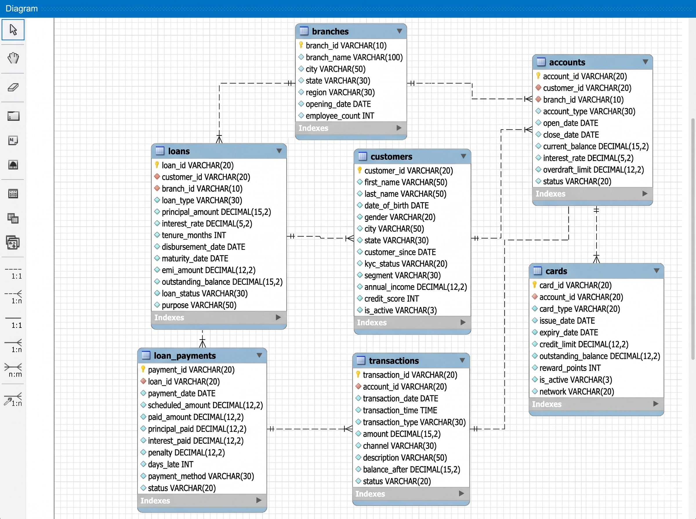

# Retail Banking Transaction Analysis (MySQL Business Analytics Project)


## Project Overview

A comprehensive end-to-end **MySQL Business Analytics Project** analyzing a retail bank's relational database across **7 interconnected tables** and **9,140 records**. Acting as a Data Analyst supporting the Retail Banking team, this project moves from ER diagram interpretation and relational database design to basic data exploration, objective-based SQL analysis, and executive business recommendations.

> **Time-Based Reference Rule:** For all time-sensitive calculations (customer tenure, customer age, and card expiry), the latest `transaction_date` in the dataset (**`2025-02-22`**) is treated as "today".

---

## Project Structure

```text
retail-banking-sql-analysis/
├── data/
│   ├── branches.csv
│   ├── customers.csv
│   ├── accounts.csv
│   ├── loans.csv
│   ├── cards.csv
│   ├── transactions.csv
│   └── loan_payments.csv
├── sql/
│   ├── table_creation.sql
│   ├── basic_analysis_queries.sql
│   └── objective_based_analysis_queries.sql
├── reports/
│   ├── Sprint_1_Business_and_Data_Understanding.docx
│   ├── Sprint_2_Database_Setup_and_Verification.docx
│   ├── Sprint_3_Basic_Analysis_and_Exploration.docx
│   └── Sprint_4_Objective_Based_Analysis_and_Insights.docx
├── presentation/
│   └── retail_banking_presentation.pptx
├── images/
│   └── ER_Diagram.png
└── README.md
```

---

## Dataset & Database Schema

The `retail_banking` database is built in MySQL in parent-to-child dependency order with full Primary Key (PK) and Foreign Key (FK) constraints:

| Table Name | Rows | Columns | Primary Key | Foreign Keys | Description |
| :--- | :---: | :---: | :--- | :--- | :--- |
| `branches` | 40 | 7 | `branch_id` | — | Branch locations, regions, opening dates, employee counts |
| `customers` | 500 | 13 | `customer_id` | — | Demographics, KYC status, segments, income, credit scores |
| `accounts` | 700 | 10 | `account_id` | `customer_id`, `branch_id` | Account types, balances, interest rates, active/closed status |
| `loans` | 300 | 13 | `loan_id` | `customer_id`, `branch_id` | Loan types, principal, EMIs, outstanding balances, status |
| `cards` | 600 | 10 | `card_id` | `account_id` | Debit/Credit cards, limits, balances, rewards, expiry dates |
| `transactions` | 5,000 | 10 | `transaction_id` | `account_id` | Transaction types, channels, amounts, descriptions, statuses |
| `loan_payments` | 2,000 | 11 | `payment_id` | `loan_id` | Scheduled vs. paid amounts, penalties, days late, methods |

### Entity-Relationship (ER) Diagram



---

## Project Sprints & Workflow

1. **Sprint 1 – Business & Data Understanding:** Studied the retail banking domain, interpreted the 7-table ER diagram, and planned 10 logical analytical solutions without SQL.
2. **Sprint 2 – Database Setup & Verification:** Created the `retail_banking` schema in MySQL (`table_creation.sql`), imported all 7 CSV files, and verified row counts and foreign key integrity.
3. **Sprint 3 – Basic Analysis / Data Exploration:** Executed 10 foundational SQL queries (`basic_analysis_queries.sql`) to establish baseline KPIs across customers, accounts, transactions, loans, and cards.
4. **Sprint 4 – Objective-Based Analysis:** Conducted deep-dive SQL analysis (`objective_based_analysis_queries.sql`) across 5 core business objectives (4.1–4.5) and translated findings into strategic recommendations.

---

## Baseline Metrics (Sprint 3)

| Metric | Verified Result |
| :--- | :--- |
| Total Customers | **500** (375 Active / 75%) |
| Total Accounts | **700** across 6 account types |
| Completed Transaction Volume | **$10,976,552.36** |
| Total Loans | **300** across 6 loan types |
| Total Outstanding Loan Balance | **$53,441,891.25** |
| Total Cards Issued | **600** (358 Debit, 242 Credit) |

---

## Key Business Findings (Sprint 4)

### 4.1 Customer Profile & Segmentation
* **Critical KYC Compliance Gap:** Only **28.6% (143/500)** of customers have `Verified` KYC; **71.4% (357)** are `Partial` (129), `Pending` (123), or `Failed` (105).
* **Balanced Segments & Credit Health:** Customers are evenly spread across 6 segments led by **Student (100)** and **Business (97)**, with healthy average credit scores (**679–687**).
* **Geographic Concentration:** **California (92)** and **Texas (58)** represent **30%** of the total customer base.

### 4.2 Account Usage & Branch Activity
* **High-Yield Deposit Drivers:** **IRA ($2.89M; 136 accounts)** and **Certificate of Deposit ($2.60M; 118 accounts; 4.62% avg rate)** account for over **53%** of total deposits.
* **Retention & Multi-Account Adoption:** **497 (71%)** accounts are Active and **203 (29%)** are Closed; **211 customers** hold multiple accounts (up to 8 per customer).
* **Top Branches:** **Washington Branch** leads total deposits (**$1.06M**), while **Jacksonville Branch** leads account volume (**67 accounts**).

### 4.3 Transaction Patterns
* **Digital Channel Leadership:** **Online (1,470 txns; $10.95M)** and **Mobile (1,024 txns; $7.48M)** drive nearly half of all activity, alongside **Branch (1,144 txns; $7.99M)**.
* **High Payment Friction:** Only **33.8% (1,688)** of transactions Completed; **32.6% (1,628; $12.46M) Failed** and **33.7% (1,684; $12.46M) are Pending**.
* **Top Descriptions:** `Investment` (1,404), `Utility` (1,320), and `Rent` (905).

### 4.4 Loan Performance & Repayment Behaviour
* **Severe Delinquency Risk:** **56.3%** of the loan portfolio is distressed — **86 Defaulted (28.7%)** and **83 In Arrears (27.7%)**.
* **Late Payments & Penalties:** Only **28.7% (573/2,000)** of payments were on time. **Education loans** incurred the highest penalties (**$20,818**), and **Jacksonville Branch** led branch penalties (**$14,012**).
* **Low Auto-Debit Adoption:** Manual methods dominate (**Cheque 388, Bank Transfer 385, Cash 375**), while **Auto Debit** is the lowest at **5.6% (112)**.

### 4.5 Card Usage & Product Engagement
* **Card Inactivity & Expiry Crisis:** **93.8% (563/600)** of cards are inactive, and **74.2% (445/600)** have expired as of `2025-02-22`.
* **Cross-Product Opportunity:** **124 customers (24.8%)** use all 3 products (Accounts + Cards + Loans), while **184 customers (36.8%)** hold 0 or only 1 product.

---

## Business Recommendations

1. **Launch a Digital KYC Remediation Drive:** Target the **357 unverified customers (71.4%)** with automated document verification to eliminate compliance risk.
2. **Audit & Resolve Transaction Failures:** Investigate the **32.6% transaction failure rate ($12.46M)** across Online, Mobile, and Branch rails to restore customer trust.
3. **Incentivize Auto-Debit for Loan Repayments:** Shift borrowers from Cheque/Cash to **Auto Debit** (currently 5.6%) and implement early-warning collections for Education loans and Jacksonville Branch.
4. **Reissue Expired Cards & Drive Activation:** Proactively replace the **445 expired cards** and launch reward-point bonuses to reactivate the **93.8% inactive card base**.
5. **Cross-Sell Bundled Products:** Target the **184 zero/single-product customers**—especially in Premium and Business segments—with bundled Account + Card + Auto-Debit Loan offers.

---

## How to Run This Project

1. Clone this repository:
   ```bash
   git clone [https://github.com/](https://github.com/)<vsanjay-21>/retail-banking-sql-analysis.git
   ```
2. Open **MySQL Workbench** and run `sql/table_creation.sql` to create the `retail_banking` database and all 7 tables.
3. Import the CSV files from `data/` in parent-to-child order:
   `branches` → `customers` → `accounts` → `loans` → `cards` → `transactions` → `loan_payments`.
4. Run `sql/basic_analysis_queries.sql` (Sprint 3) and `sql/objective_based_analysis_queries.sql` (Sprint 4) to reproduce all findings.

---

## Author

**Vijayagiri Sanjay**  
Data Analytics Enthusiast  
[](https://linkedin.com/in/sanjay999)
[](https://github.com/vsanjay-21)
